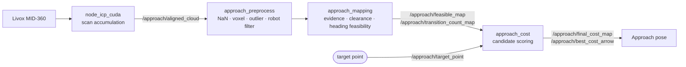

# approach

**Manipulation-aware approach mapping for a mobile manipulator (RB-Y1), built on ROS 2.**

Nav2 brings the robot *near* a target. This workspace decides *where and in which heading* the robot should finally stand so that its arm can reach the target, using a dedicated local map built from a 3D LiDAR.


Developed for RoboCup@Home 2026 (team Inha-United).

---

## Why

A global navigation map is built to keep a robot *safe*, not to put it in a *manipulation-ready* pose.

- A 2D LiDAR only sees one horizontal slice, so table tops and other overhanging obstacles are missing from the map.
- A large footprint plus conservative inflation keeps the base too far from the target.
- Full 3D mapping was too expensive for the onboard computer, which is shared with perception and manipulation.

This workspace projects 3D LiDAR points into a 2D grid that is used **only for the final approach**, and scores candidate stand-off poses on it.

## Pipeline



| Stage | What it does |
|---|---|
| Accumulation | Registers consecutive MID-360 scans with fast_GICP to densify the sparse point cloud. |
| Preprocess | Removes NaNs and points on the robot body, voxel-downsamples (0.07 m), and removes statistical outliers. |
| Evidence map | Splits points by height into ground (−0.40 to 0.10 m) and obstacle (0.25 to 1.50 m) and accumulates per-cell evidence with hysteresis. |
| Clearance map | Distance from every cell to the nearest obstacle, by 8-neighbour propagation. |
| Heading-feasible map | For each of 16 heading bins, whether the rotated robot footprint (0.70 × 0.60 m + 0.05 m margin) fits at that cell. |
| Cost | Scores feasible cells by distance to target, local stability and distance from the robot. |

## Key ideas

### Persistent evidence with hysteresis

Cells are not cleared just because they are out of view. Each update adds capped evidence and the state only flips when a threshold is crossed:

```text
score[c] = clip(score[c] + w_obs * min(obs_hits[c], cap) - w_gnd * min(gnd_hits[c], cap), -clip, +clip)

score >= occupied_threshold  ->  obstacle
score <= -free_threshold     ->  free
otherwise                    ->  keep previous state
```

The robot can drive to another area and come back without the map forgetting what it saw, and single noisy frames do not flip cells.

### Heading-aware feasibility instead of circular inflation

Footprint stencils are precomputed once per heading bin. Feasibility is then a lookup of every stencil offset around a cell, so a rectangular robot can stand close to an object in the headings where it actually fits.

### Approach cost

For every feasible candidate cell:

1. distance from the target point
2. stability, from how often the cell's neighbourhood changed state (frequently changing cells are noisy or dynamic)
3. distance from the robot's current position

Each term is min-max normalized over the candidate cells and combined as a weighted average. `compute_final_cost()` is the extension point for task-specific terms (only mode 1 is implemented).

## Packages

| Package | Type | Description |
|---|---|---|
| [`approach_preprocess`](approach_preprocess) | library | Point-cloud filters shared by the runners. |
| [`approach_mapping`](approach_mapping) | library | Evidence, clearance and heading-feasibility maps. ROS-free core. |
| [`approach_cost`](approach_cost) | library | Candidate scoring on top of `approach_mapping`. |
| [`approach_icp`](approach_icp) | library | Registration wrapper, TF utilities and timing metrics around fast_gicp. |
| [`approach_map_runner`](approach_map_runner) | nodes | ROS 2 nodes, launch files and parameters. |
| [`fast_gicp`](fast_gicp) | third party | Vendored [fast_gicp](https://github.com/SMRT-AIST/fast_gicp), built locally with CUDA 12.6. |

## Requirements

- Ubuntu 22.04, ROS 2 Humble
- PCL, Eigen3, yaml-cpp
- CUDA 12.6 (only for `fast_vgicp_cuda`)
- `inha_interfaces` — the team's message/service package. It is not in this repository and must be in the same workspace.

## Build

```bash
mkdir -p ~/robocup_ws/src && cd ~/robocup_ws/src
git clone https://github.com/PGW63/approach.git
# inha_interfaces must also be in src/

cd ~/robocup_ws
rosdep install --from-paths src --ignore-src -r -y
colcon build --symlink-install --cmake-args -DCMAKE_BUILD_TYPE=Release
source install/setup.bash
```

`approach_icp` first looks for a local fast_gicp install under `fast_gicp/local_install`, then falls back to the workspace package. See [the local build guide](approach_icp/docs/fast_gicp_local_build_guide_ko.md) for the CUDA build.

## Run

```bash
ros2 launch approach_map_runner map_runner_with_cost.launch.py use_sim_time:=false
```

This starts `approach_map_runner_node`, `approach_cost_runner_node` and `approach_waiting`. Mapping is triggered through the `/approach/mapping` service, and the target is given on `/approach/target_point`.

### Topics

| Topic | Direction | Description |
|---|---|---|
| `/approach/aligned_cloud` | in | Accumulated, registered point cloud |
| `/approach/target_point` | in | Object to approach |
| `/approach/obstacle_map` | out | Evidence-based obstacle grid |
| `/approach/clearance_map` | out | Distance to nearest obstacle |
| `/approach/feasible_map` | out | Heading-feasible cells (bin selected by `publish_heading_bin`) |
| `/approach/transition_count_map` | out | State-change counts used for the stability cost |
| `/approach/final_cost_map` | out | Final candidate cost |
| `/approach/best_cost_arrow` | out | Best approach pose, for RViz |

### Configuration

| File | Contents |
|---|---|
| [`approach_map_runner/config/runner_config.yaml`](approach_map_runner/config/runner_config.yaml) | Topics, height bands, preprocessing, robot filter box |
| [`approach_mapping/config/map_config.yaml`](approach_mapping/config/map_config.yaml) | 5 × 5 m grid at 0.10 m, evidence weights and thresholds, footprint, heading bins |
| [`approach_cost/config/cost_config.yaml`](approach_cost/config/cost_config.yaml) | Cost mode and weights |
| [`approach_map_runner/config/cost_runner_config.yaml`](approach_map_runner/config/cost_runner_config.yaml) | Cost runner topics and frames |

## Scan registration benchmark

Average wall time per registration on the development PC (RTX 4060 Ti, 16 GB RAM). Full numbers and plots: [icp_benchmark_ko.md](approach_icp/docs/icp_benchmark_ko.md).

| Method | Avg wall time |
|---|---:|
| PCL ICP | 31 ms |
| PCL GICP | 2,895 ms |
| fast_GICP, 1 thread | 511 ms |
| fast_GICP, 4 threads | 150 ms |
| fast_VGICP, 1 thread | 515 ms |
| fast_VGICP, 4 threads | 138 ms |
| fast_VGICP, CUDA | 50 ms |

**Chosen:** fast_GICP with 1 thread at 1 Hz (about 60 % of one CPU core), to leave CPU and GPU for perception and manipulation running on the same computer.

## Repository layout

```text
approach/
├── approach_preprocess/      # point-cloud filters (library)
├── approach_mapping/         # evidence / clearance / feasibility maps (library)
│   ├── config/
│   └── docs/                 # design report, algorithm flow, code rationale
├── approach_cost/            # candidate scoring (library)
│   ├── config/
│   └── docs/
├── approach_icp/             # registration wrapper around fast_gicp (library)
│   └── docs/                 # benchmark, CUDA build notes, integration reports
├── approach_map_runner/      # ROS 2 nodes, launch, parameters
│   ├── config/
│   └── launch/
└── fast_gicp/                # vendored third-party registration library
```

## Documentation

- [Approach map design report](approach_mapping/docs/approach_map_report.md)
- [Map algorithm flow](approach_mapping/docs/map_algorithm_flow.md)
- [Map code rationale](approach_mapping/docs/map_code_rationale.md)
- [Cost design](approach_cost/docs/cost_design.md)
- [ICP benchmark](approach_icp/docs/icp_benchmark_ko.md)

## Assumptions and limitations

- The floor is assumed flat; ground/obstacle separation is a fixed height band.
- Only cost mode 1 is implemented.
- A planning runner for driving to the selected pose is stubbed out in the launch file.
- Accuracy of the selected pose has not yet been measured against ground truth. `TODO`

## Related

- [close_approach](https://github.com/inha-united-athome/close_approach) — closes the final centimetres from the selected pose using perception-based SE(2) error.
- [get_seg_3d_coord](https://github.com/PGW63/get_seg_3d_coord) — estimates the 3D target point used here.

## Author

Gunwoo Park ([@PGW63](https://github.com/PGW63)) — Inha University, Smart Mobility Engineering
