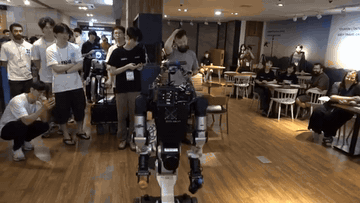
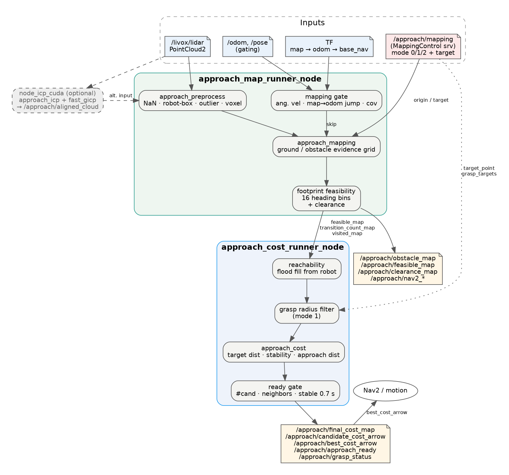
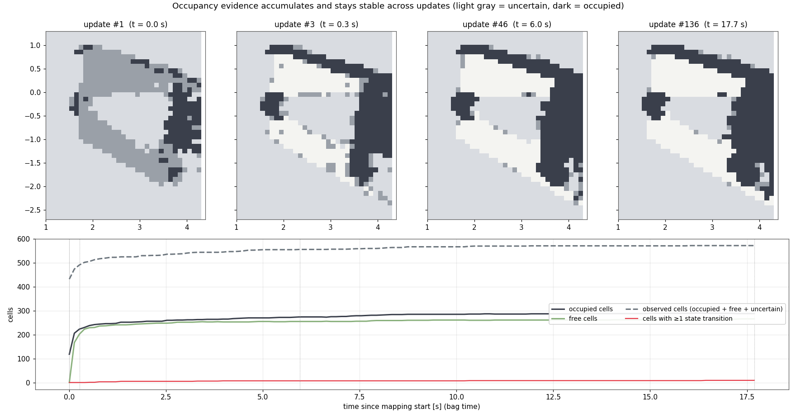
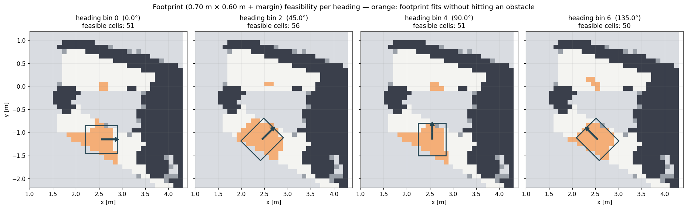
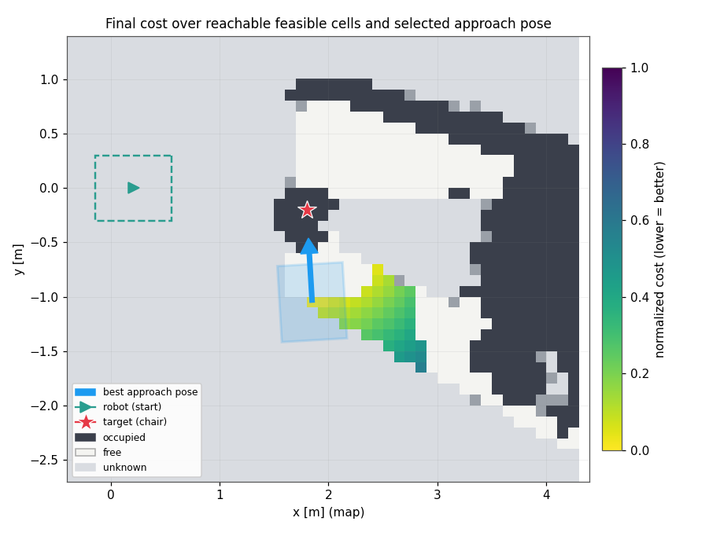

<div align="center">
  <h1>Interaction Approach Mapping & Cost-Based Goal selection</h1>
  
  
  
</div>

Ros2-based close-range mapping and approach goal generation for mobile Robot interaction


# Overview
Conventional robot navigation focuses on reaching a goal while avoiding obstacles. However, in interaction tasks, the target coordinates ***may lie within an occupied region***. The robot must therefore identify a collision-free, reachable approach pose near the target while maintaining an appropriate orientation for interaction.

This Project implements a ROS2 pipeline for **local interaction mapping, feasible candidate filtering, multi-criteria cost evaluation, and stable goal pose generation.** The approach workflow was integrated with Nav2 and other select-Target vision models.

# Demonstration
<div align="center">
  
</div>

*Given the coordinates of a table next to a seated woman, the robot generates an approach cost map, selects an optimal approach pose, and autonomously navigates to the selected goal.*


# System Architecture

<div align="center">
  
</div>

|Node|Responsibility|
|---|---|
|`approach_map_runner_node`| Point cloud preprocessing, localization-aware update gating, persistent mapping, clearance, footprint feasibility, and visited-region outputs |
|`approach_cost_runner_node`| Reachability and interaction-range filtering, cost evaluation, candidate stability, final goal publication|
|`node_icp_cuda` (optional)|Point cloud registration & acuumulation using PCL or Fast GICP backends|

The default mapping configuration consumes `/livox/lidar`

## Key Components
### 1. Reliable Local Mapping
<div align="center">
  
</div>

  **Constructs a persistent local occupancy map from 3D LiDAR observations while minimizing the influence of sensor noise and localization errors.**
  - Point Cloud Preprocessing: Applies voxel downsampling, outlier removal, and robot-body filtering to improve mapping efficiency and reliability.
- Localization-Aware Mapping: Monitors angular velocity, TF corrections, and localization covariance to prevent unreliable observations from corrupting the map.
- Evidence-Based Occupancy Mapping: Accumulates ground and obstacle evidence across multiple observations, preserving previously estimated cell states under uncertainty.


### 2. Feasible Approach Region Generation
<div align="center">
  
</div>

  **Identifies collision-free and reachable approach regions by considering the robot's physical footprint and surrounding obstacles.**

- Footprint-Aware Feasibility: Evaluates collision feasibility using rotated rectangular footprint masks across 16 discrete heading directions.
- Reachability Filtering: Uses flood-fill search to exclude candidate regions disconnected from the robot's current reachable area.
- Interaction Range Filtering: Restricts approach candidates to positions within the configured interaction radius of the target object.


### 3. Cost-Based Approach Goal Selection
<div align="center">
  
</div>


  **Selects a suitable approach goal by balancing target proximity, environmental stability, and travel distance.**

- Multi-Criteria Cost Evaluation: Combines normalized target distance, occupancy-state stability, and robot-to-candidate distance using configurable weights.
- Target-Facing Orientation: Calculates the desired heading toward the target object to generate the final approach pose $(x,y,\theta)$.
- Stable Goal Selection: Validates candidate density and temporal stability before publishing the approach goal for Nav2 execution.
Cost-Based Approach Selection


# Requirements and Build
- PCL, Eigen, and relevant ROS 2 message and TF dependencies.
- This project depends on inha_interfaces, a custom ROS 2 interface package used for communication between system components. The interface definitions are not included in this repository and must be provided separately.
- Fast GICP dependency for optional registration.
```
mkdir -p ~/approach_ws/src
cd ~/approach_ws/src
git clone https://github.com/PGW63/approach.git

cd ~/approach_ws
colcon build --symlink-install --packages-up-to approach_map_runner
source install/setup.bash
```

# Run
## Run mapping and Cost Evaluation
```
ros2 launch approach_map_runner map_runner_with_cost.launch.py
```
This launches `approach_map_runner_node` and `approach_cost_runner_node` with their default **YAML** files.

## Optional ICP Node
```
ros2 launch approach_map_runner icp_runner.launch.py
```
The ICP node is **not launched by** `map_runner_with_cost.launch.py`

## Configurations
| File | Key parameters |
| --- | --- |
| `approach_mapping/config/map_config.yaml` | Grid resolution/size, evidence thresholds, footprint dimensions, heading bins |
| `approach_cost/config/cost_config.yaml` | Target/stability/approach weights |
| `approach_map_runner/config/runner_config.yaml` | Input topics, map frame, height filters, localization gating, visited path |
| `approach_map_runner/config/cost_runner_config.yaml` | Reachability radius, grasp range, candidate counts, stability criteria |
| `approach_map_runner/config/icp_config.yaml` | Optional registration node settings |

**More details are at** [config_ko.md](docs/config_ko.md)

# Limitations
- **Final orientation feasibility** : The target-facing yaw is calculated after position selection and is not explicitly checked against the corresponding heading mask.
- **Environment assumptions** : Height-threshold ground/obstacle separation is tuned for relatively flat indoor environments.
- **Reproducibility** : External robot interfaces, calibration, and Nav2 integration require environnment-specific configurations.

# Implementation Reference
- [Grid Map](https://github.com/anybotics/grid_map)

